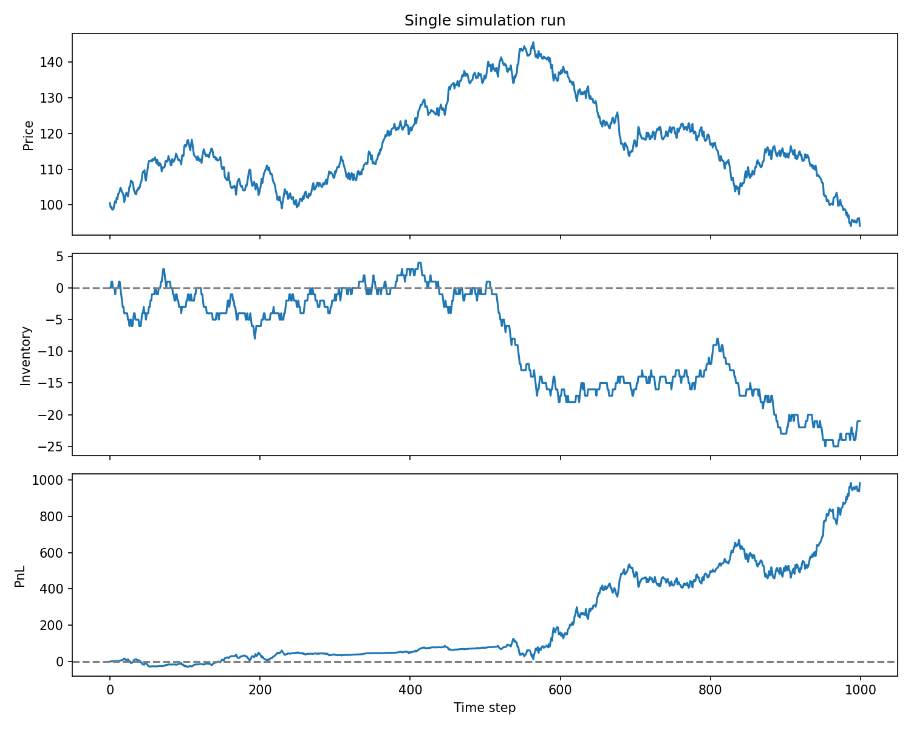
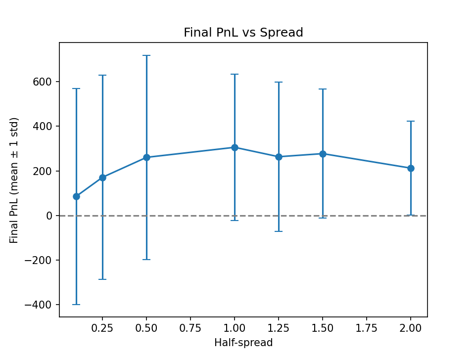
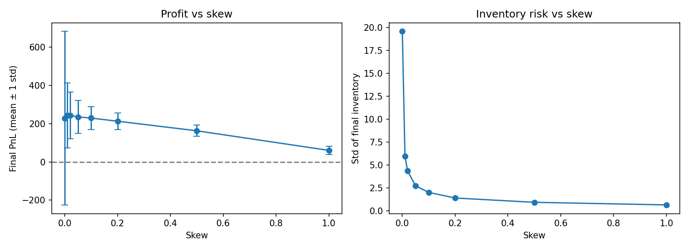
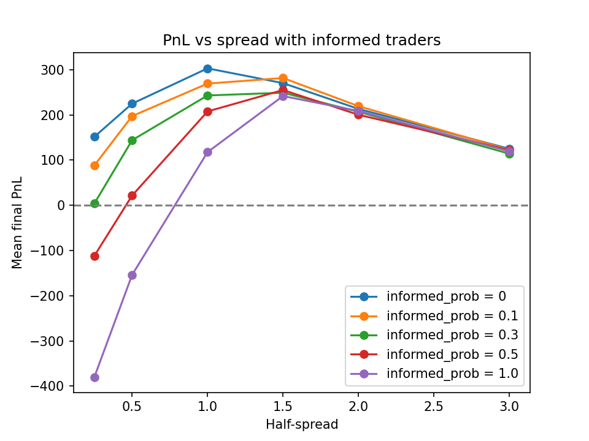

# Market-Making Simulator

A Python simulation of a simple market maker quoting a bid and ask around a random-walk price. I study how spread width, inventory skew, and adverse selection affect profit and risk.

## Model

**Price.** The true price starts at 100 and follows a random walk of 1,000 steps. At each step, it changes by a normally distributed percentage move with standard deviation 1% of the starting price, so it moves roughly ±1 per step. The market maker cannot predict it.

**Quotes.** At each step the market maker quotes:

- bid = price − half_spread − skew × inventory
- ask = price + half_spread − skew × inventory

`half_spread` sets how far the quotes sit from the true price. `skew` shifts both quotes down when the market maker is long (to attract buyers and discourage sellers) and up when it is short. With `skew = 0` the quotes ignore inventory.

**Random traders.** A buyer lifts the ask with probability `base × exp(−(ask − price))`, and a seller hits the bid with probability `base × exp(−(price − bid))`, with `base = 0.4`. So quoting further from the true price attracts fewer traders. Each trade is one unit.

**Informed traders.** With probability `informed_prob` per step, an informed trader arrives who can see the next price. They buy at the ask if the next price is above it, sell at the bid if the next price is below it, and otherwise stay out. They are in addition to the random traders. By construction, they only trade when the market maker loses.

**PnL.** PnL is marked to market: cash plus inventory valued at the current price.

PnL = cash + inventory x current price



*One example run: the true price (top), the market maker's inventory (middle), and its mark-to-market PnL (bottom)*

## Assumptions and limitations

- **Prices are a pure random walk,** with no trends, jumps, or changing volatility. Real prices have all of these, and trends in particular are bad for a market maker.
- **The arrival curve `base × exp(−distance)` is a modelling choice,** not fitted to data. 
- **Informed traders see the next price exactly.** Real informed traders have noisy, partial information, so adverse selection here is stronger and cleaner than in practice.
- **No fees, no latency, no position limits, no order book.** Every trade is one unit at the quoted price, and there is no queue position or partial fills.
- **Within a step, informed traders act first and the random traders use the same quotes,** even if an informed trade has just changed inventory. 
- **Inventory has no expected cost in the base model.** Because the price is a random walk, holding inventory adds risk but no systematic loss. 

## Experiment 1: how wide should the spread be?

I ran 1,000 simulations at half-spreads varying from 0.1 to 2.0 and recorded the final PnL.



*Mean final PnL against half-spread. Bars show ±1 standard deviation of final PnL across runs.*

| Half-spread | Mean PnL | Std of PnL | Mean / std | Formula estimate |
|---|---|---|---|---|
| 0.1 | 85.5 | 484.9 | 0.18 | 72 |
| 0.25 | 171.3 | 459.3 | 0.37 | 156 |
| 0.5 | 260.8 | 458.6 | 0.57 | 243 |
| 1.0 | 305.8 | 329.1 | 0.93 | 294 |
| 1.25 | 263.6 | 335.5 | 0.79 | 287 |
| 1.5 | 277.5 | 289.7 | 0.96 | 268 |
| 2.0 | 212.4 | 211.5 | 1.00 | 217 |

Mean PnL rises with the spread, peaks at a half-spread of about 1.0 (mean final PnL ≈ 306 over 1,000 runs), and falls beyond that. The reason is a trade-off: a wider spread earns more per trade but attracts fewer traders. To verify by hand, expected PnL is roughly (steps) × (chance of a trade per step) × (half-spread). At a half-spread of 1.0 the chance of a trade per step is 2 × 0.4 × e^−1 ≈ 0.29, giving about 1000 × 0.29 × 1.0 ≈ 294. The simulation’s 306 is within about one standard error (≈ 10) of that, so the two agree.

The standard deviation of final PnL falls from about 485 to about 210 as the spread widens, because fewer trades means less inventory exposed to price moves. Mean divided by standard deviation (a rough profit-per-unit-of-risk measure) therefore keeps rising with the spread, from 0.18 to 1.00. Even at the best spread the ratio is only 0.93, so a meaningful share of individual runs still lose money.

## Experiment 2: inventory skew

I fixed the half-spread at 0.5 and varied the skew from 0 to 1.0.



*Left: mean final PnL ±1 standard deviation against skew. Right: standard deviation of final inventory against skew.*

| Skew | Mean PnL | Std of PnL | Mean / std | Std of final inventory |
|---|---|---|---|---|
| 0 | 228.5 | 453.0 | 0.50 | 19.6 |
| 0.01 | 242.1 | 169.5 | 1.43 | 5.9 |
| 0.02 | 242.9 | 122.6 | 1.98 | 4.3 |
| 0.05 | 235.1 | 85.6 | 2.75 | 2.7 |
| 0.1 | 228.7 | 60.4 | 3.79 | 2.0 |
| 0.2 | 212.4 | 43.7 | 4.86 | 1.4 |
| 0.5 | 162.5 | 29.2 | 5.57 | 0.9 |
| 1.0 | 60.1 | 22.4 | 2.68 | 0.6 |

A small skew cuts risk dramatically at almost no cost. At skew 0.1, the standard deviation of final PnL drops by about a factor of seven and inventory stays within a couple of units of zero, while mean PnL falls only slightly.

The cost appears once the skew gets large. A skew of 1.0 means holding just one unit moves each quote by 1.0, which is twice the half-spread. The market maker then starts selling below the true price on purpose to shed inventory, which erases the spread it earned opening the position. Profit per unit of risk (mean divided by standard deviation) peaks at an intermediate skew, around 0.2 to 0.5, and falls again at 1.0.

## Experiment 3: adverse selection

I varied `informed_prob` from 0 (no informed traders) to 1.0 (an informed trader looking at every step) and changed the spread for each.



*Mean final PnL against half-spread, one line per probability of an informed trader arriving each step.*

| informed_prob | 0.25 | 0.5 | 1.0 | 1.5 | 2.0 | 3.0 |
|---|---|---|---|---|---|---|
| 0 | 151.6 | 224.8 | **303.0** | 270.3 | 213.2 | 125.0 |
| 0.1 | 88.2 | 197.3 | 269.3 | **281.6** | 219.4 | 122.8 |
| 0.3 | 4.0 | 144.0 | 243.0 | **249.1** | 206.9 | 114.1 |
| 0.5 | −111.8 | 21.5 | 207.6 | **255.0** | 200.3 | 122.1 |
| 1.0 | −380.1 | −154.0 | 117.6 | **241.7** | 208.7 | 119.3 |


Informed traders are very damaging to tight spreads. At a half-spread of 0.25, mean PnL goes from +152 with no informed traders to −380 with an informed trader at every step. At 0.5 it goes from +225 to −154. Wide spreads protect the market maker, since an informed trader only trades when the price will move by more than the half-spread, and big moves are rare. At a half-spread of 2.0 the informed traders barely matter (213 against 209), and at 3.0 all five lines converge at about 115 to 125. But profit is low because few random traders accept such wide quotes.

The best spread shifts to the right as informed trading increases, from about 1.0 to 1.5. For `informed_prob` of 0.1 and 0.3 the gap between 1.0 and 1.5 is within noise, but at 0.5 and 1.0 the move to 1.5 is clear (about 47 and 124 higher than at 1.0). This is the same reason real market makers widen spreads when they expect informed trading. Even at its best spread, the market maker earns less when informed traders are present (about 242 against 303 at the extreme), a loss of roughly 20%.

## Key findings

1. Without informed traders, mean PnL is highest at a half-spread of about 1.0 (roughly 300 over 1,000 steps), with a plateau out to about 1.5, and the simulation agrees with a simple formula for expected profit.
2. A skew of 0.1 cuts the standard deviation of final PnL by about 7.5 times with no change in mean PnL, but a skew comparable to the half-spread (1.0) cuts mean PnL by about 74%.
3. Informed traders turn tight spreads into losses (a half-spread of 0.25 goes from +152 to −380) and move the best spread from about 1.0 to about 1.5, at a cost of roughly 20% of maximum profit.

## How to run

```
pip install numpy matplotlib
python market_maker.py
```

The full run (three experiments at 1,000 simulations per setting) takes several minutes. For a quick test, lower `n_runs` in the script. A random seed (52) is set once at the start so results are reproducible. Results depend on the order the experiments run in, so changing the code can change the exact numbers, but the shapes should not change.
